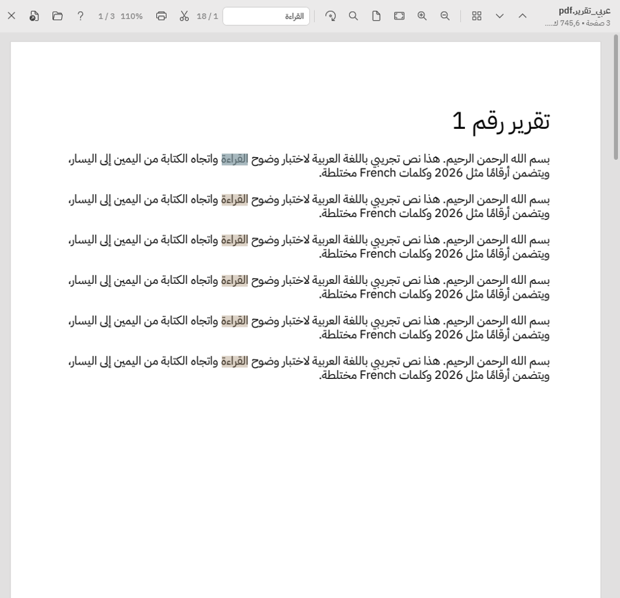
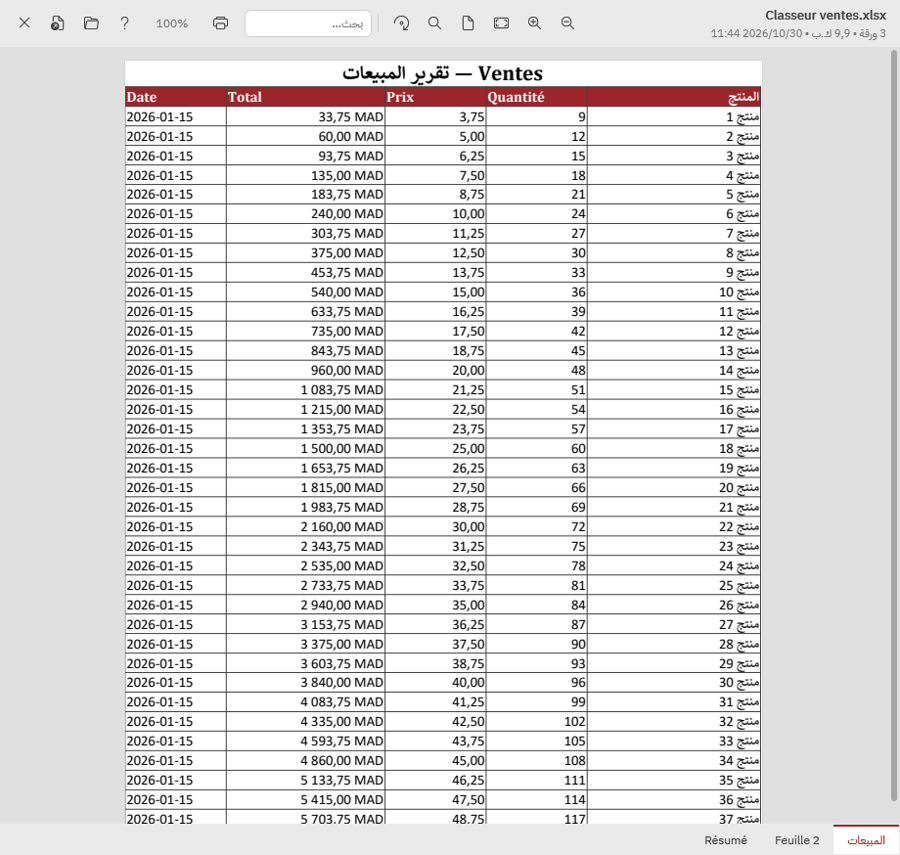
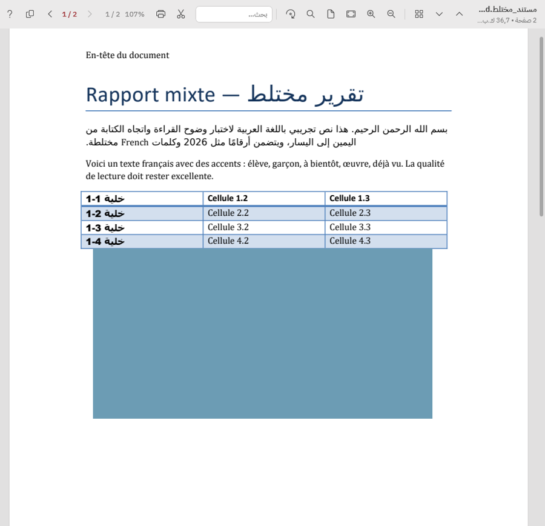
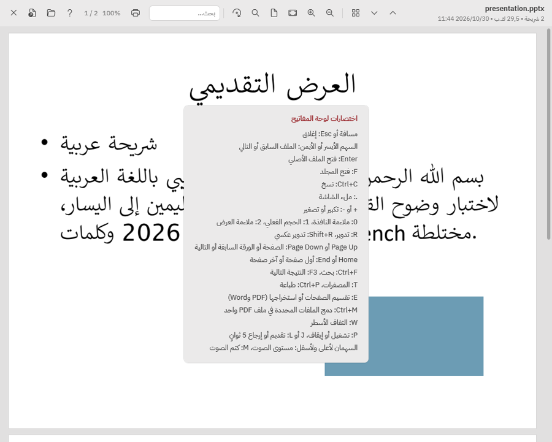

# Lamha · لمحة

**Quick Look for Windows 11, with a full Arabic interface.** Select files in File Explorer, press Space, and read them in a
floating window without opening another program. Press Space again and you are back where you were.

Lamha works offline, needs no administrator rights, and does not need Microsoft Office.

[دليل الاستخدام بالعربية](docs/USER_GUIDE_AR.md)

<p align="center">
  
  
</p>

## Features

- **Space to preview** from File Explorer and the desktop, with focus returned to Explorer on close. Space keeps its
  normal behavior everywhere else: rename boxes, the address bar, search, and other programs.
- **Documents:** PDF, Word (DOCX, DOC), Excel (XLSX, XLS) and PowerPoint (PPTX, PPT), rendered sharp at any zoom, with
  search (including Arabic stored as presentation forms or in visual order), thumbnails, rotation and printing.
- **Images:** PNG, JPG, WebP, GIF (animated), BMP, TIFF and SVG, with zoom, rotation and EXIF orientation.
- **Text:** TXT, Markdown, JSON, XML, HTML and CSV, with encoding detection (UTF-8, UTF-16, Windows-1256, Windows-1252),
  right-to-left layout and syntax highlighting.
- **Media:** MP4 and MP3.
- **Page tools:** split a PDF or Word document into one PDF per page, extract the current page, or merge several selected
  files into one PDF. Results are saved next to the originals; nothing is overwritten.
- **Keyboard first:** every action has a shortcut. Press F1 in the preview for the list.
- **Arabic interface** throughout, right to left, in IBM Plex Sans Arabic. Document content keeps its own language and direction.

<p align="center">
  
  
</p>

## Install

Download `Lamha-Setup-<version>.exe` from the [Releases](../../releases) page and run it. It installs for the current
user only, starts with Windows, and sits in the notification area. The installer is not code-signed, so Windows
SmartScreen may warn on first run: choose *More info*, then *Run anyway*.

Uninstalling removes the app, its settings, logs and cache, and its startup entry.

## Privacy and safety

- No network access, no telemetry, no accounts.
- Files are opened read-only. Office files are copied to a temporary folder before conversion, so nothing is written
  beside the original.
- Macros and scripts in documents are disabled; SVG files are stripped of external references before parsing.
- Logs record file types, never file names or content.

## How it works

A low-level keyboard hook reacts to Space only when Explorer's file list has focus, and reads the selection through the
Windows Shell. PDFs are rendered with [PDFium](https://pdfium.googlesource.com/pdfium/). Office files are converted to PDF
by a bundled, trimmed [LibreOffice](https://www.libreoffice.org/) running headless with macros disabled.

[docs/ARCHITECTURE.md](docs/ARCHITECTURE.md) explains the design and the decisions behind it.

## Build from source

Requirements: Windows 10 2004 or later (x64), the .NET 10 SDK, and, for the installer, Inno Setup 6 and a LibreOffice
installation to bundle.

```powershell
dotnet build Lamha.slnx
dotnet test tests\Lamha.Tests\Lamha.Tests.csproj
powershell -ExecutionPolicy Bypass -File build.ps1    # dist\Lamha-Setup-1.0.0.exe
```

[docs/BUILD.md](docs/BUILD.md) has the details. [docs/TESTING.md](docs/TESTING.md) describes what has been tested,
how, and the known limitations.

## Contributing

Issues and pull requests are welcome. Please:

- keep the interface in Arabic and right to left;
- run the unit tests, and for changes to Explorer integration, `tests\e2e-explorer.ps1` on an unlocked desktop;
- never add network access or anything that writes to a previewed file.

## License

Lamha is released under the [MIT License](LICENSE). It bundles third-party components under their own licenses,
including PDFium (BSD-3-Clause and Apache-2.0), LibreOffice (MPL-2.0) and IBM Plex Sans Arabic (SIL OFL 1.1).
See [docs/LICENSES.md](docs/LICENSES.md).
